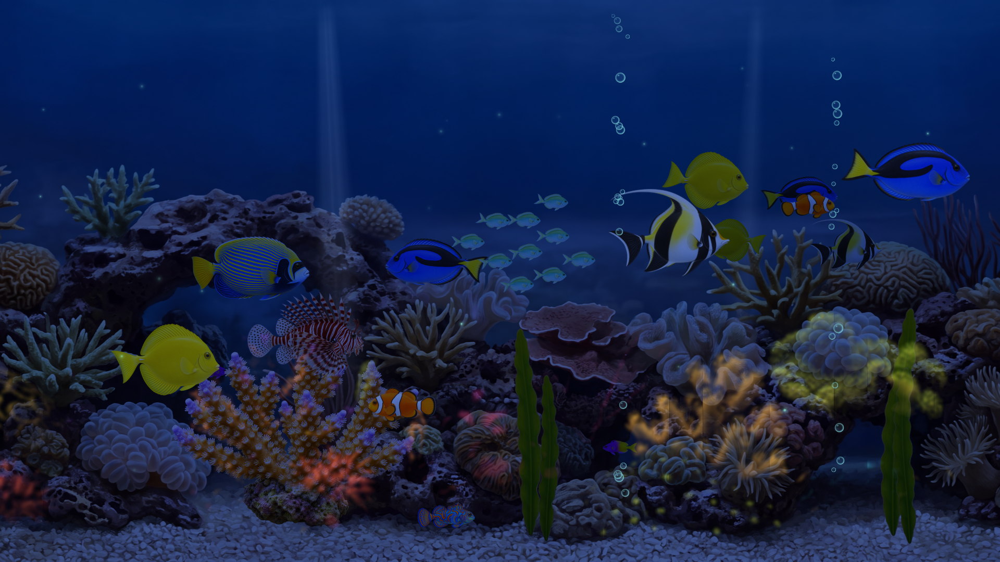
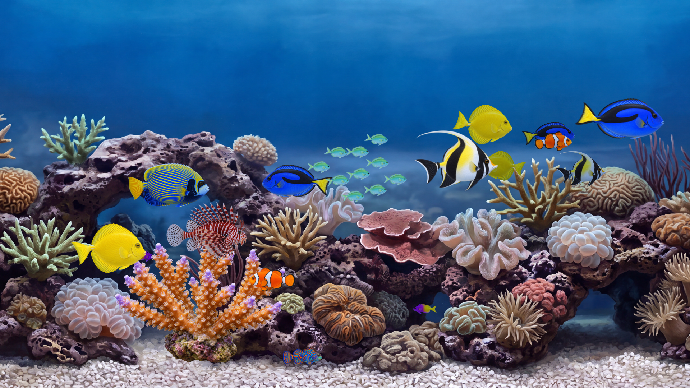
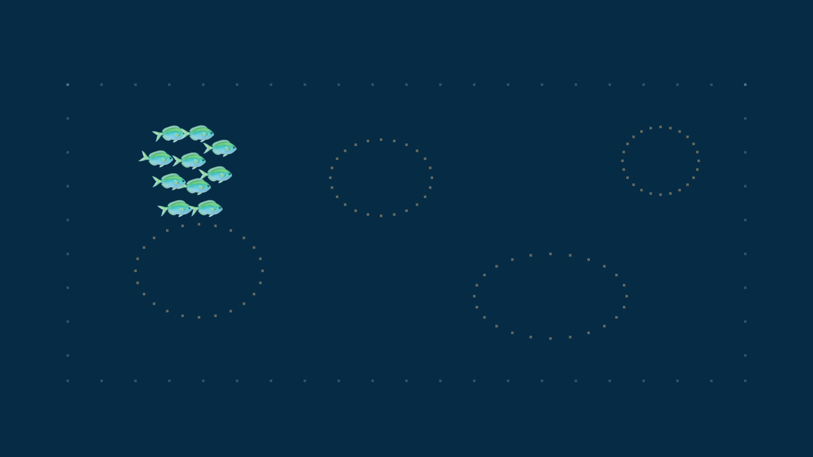
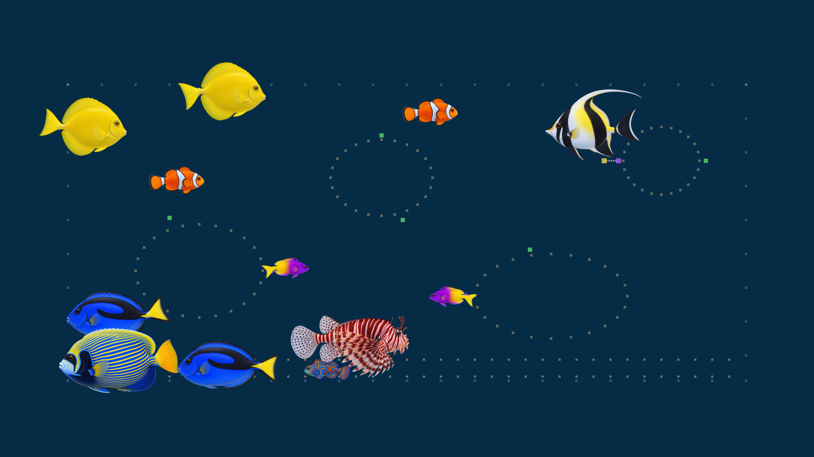
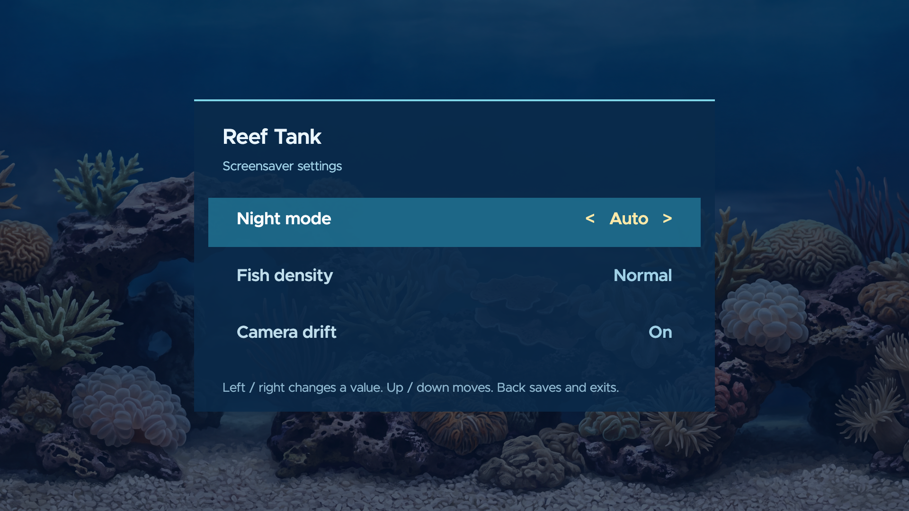

# REEF TANK

## Table of Contents

* [About](#about)
* [Features](#features)
   * [Core Capabilities](#core-capabilities)
   * [Advanced Features](#advanced-features)
   * [Technical Excellence](#technical-excellence)
* [Screenshots](#screenshots)
* [Prerequisites for running](#prerequisites-for-running)
* [Prerequisites for dev](#prerequisites-for-dev)
* [Installing](#installing)
   * [Enable developer mode on the Roku](#enable-developer-mode-on-the-roku)
   * [Install the toolchain and build](#install-the-toolchain-and-build)
   * [Sideload to the Roku](#sideload-to-the-roku)
   * [Select Reef Tank as the screensaver](#select-reef-tank-as-the-screensaver)
* [Project layout](#project-layout)
* [Make targets](#make-targets)
* [Browser preview](#browser-preview)
   * [Visual screenshot gate](#visual-screenshot-gate)
   * [Fidelity scene](#fidelity-scene)
* [Deploy](#deploy)
* [Device performance](#device-performance)
* [FAQ](#faq)
* [Roadmap](#roadmap)
    * [Where we are](#where-we-are)
    * [Where we're going](#where-were-going)
* [License](#license)
* [What's new](#whats-new)


-blue)


## About
Reef Tank is a custom Roku **screensaver** channel: a procedurally animated tropical-reef tank
built to replace Roku's "Aquatic Life" screensaver (removed December 1, 2026). It is not in
the Channel Store: installing it means enabling Roku's developer mode (a one-time,
~5-minute sequence on the remote) and sideloading the channel from a computer — see
[Installing](#installing). Once sideloaded you enable it like any screensaver under
**Settings > Theme > Screensavers**.

Each fish is a rigged cutout with an undulating body and tail, driven by a per-species behavior
brain: fish cruise, dart, turn, school, graze, hide and weave in front of and behind the rock and
coral. Around them are bubbles, swaying seaweed, anemones and invertebrates, scrolling
caustics, and a slow parallax camera drift. After sunset the tank switches to a
moonlit night mode with glowing coral and bioluminescent sparkles, computed from real sunrise and
sunset times at Woodland, CA. There are no Roku logos anywhere.

The whole channel is one BrightScript/SceneGraph codebase. On the Mac the same code runs in a
browser through brs-engine, so iteration needs no TV; deploying sideloads the same files to the
Roku. See `PRD.md` for scope and phases, `plans/` for the per-phase task plans, and
`RESEARCH.md` for the full feasibility research.

[](https://buymeacoffee.com/probello3)

## Features

### Core Capabilities
- **Layered parallax tank**: the reef is a stack of named layer Groups (backdrop, rockwork, coral
  lanes, foreground, bubbles) inside a drifting `camera` Group, each with its own
  parallax factor, built from `config/scene.json`
- **Procedural fish**: every species is a rigged sprite (body, tail, fins, crest) whose parts
  animate by transforms — undulation, tail beats with depth foreshortening, turns, dart bursts
- **Per-species behavior brains**: `FishBrain` state machines per species kind — grazers cruise
  and peck rocks, the royal gramma retreats tail-first into its den, the mandarin hops the sand
  band, the lionfish drifts, the arch swimmer passes through the backdrop arch
- **Chromis school**: boids flocking (`components/lib/school.brs`) behind a hidden wandering
  leader with a spacing guard
- **Day/night cycle**: solar math drives dusk and night; moonlight tints, glowing coral,
  bioluminescence and night-only flashlight fish; sunrise/sunset for Woodland, CA in device
  local time
- **Ambient life**: realistic bubble columns, swaying segmented seaweed, anemones, a crab, a
  shrimp and scrolling caustics
- **Settings screen**: `RunScreenSaverSettings()` on the device (Settings > Theme > Screensavers >
  Reef Tank) for fish density, camera drift and night mode, persisted in the device registry

### Advanced Features
- **Browser preview of the real channel code**: `make dev` runs the unmodified channel in
  brs-engine; `?seed=`, `?time=`, `?speed=`, `?freeze=` give deterministic, repeatable frames
- **Config-driven behavior**: layers, lanes, decor and population in `config/scene.json`; species
  kinds in `behavior.json`; steering in `brain.json`/`school.json` — changing feel usually means
  editing JSON, not code
- **Deterministic seeding**: a seeded PRNG drives brains and the school, so the same seed always
  produces the same tank
- **Density presets**: calm / normal / busy populations, selectable in settings and in device
  perf runs
- **Art pipeline**: AI-generated originals with prompts, seeds and provenance (`assets/source/`,
  never shipped) are rigged into layered sprites and key art by byte-reproducible Python tools
- **Perf probes**: fish/layer ramp probes and per-scene device checks log fps and texture use to
  `docs/perf/`

### Technical Excellence
- **175 BrightScript unit tests** under brs-cli (`make test`, `make test FILTER=<substring>` for
  a subset) covering the pure logic in `components/lib/`
- **Playwright screenshot gate**: frozen deterministic frames compared against committed
  baselines (`make test-visual`)
- **Warning-free gate**: `make checkall` fails on any bsc/bslint warning; `api-guard` rejects
  OS 16-only APIs the simulator would silently accept; `zip-check` keeps the device package
  minimal
- **Fidelity harness**: a dedicated scene exercising every SceneGraph primitive, validated per
  build and compared simulator-vs-device (`docs/fidelity/`)
- **Pinned toolchain**: every build tool pinned in `package.json`, installed with bun

## Video

15 seconds of day, then night — the real channel running in the browser preview:

[](https://youtu.be/KN0P7S0MsjQ)

## Screenshots
The full tank by day and night, the chromis school, species behaviors and the settings screen.










## Prerequisites for running
* A Roku streaming player on your LAN with developer mode enabled (see
  [Installing](#installing) below — it takes about two minutes with the remote)
* No store listing: Reef Tank is a sideloaded personal channel (see `RESEARCH.md` §3)

## Prerequisites for dev
* [bun](https://bun.sh) (package manager; never run `node` on project scripts)
* GNU make
* Node.js (the `brs-cli` test binary runs under node via its shebang)
* [uv](https://docs.astral.sh/uv/) + Python 3 for the art pipeline (`make art`, `make key-art`)
* Playwright Chromium (auto-installed by `make test-visual`)

## Installing
**Illustrated step-by-step guide: [docs/install-guide.md](docs/install-guide.md)** — the
same steps with screenshots (terminal, key-sequence diagram, on-device results).

Prefer having an AI agent do it: copy
[docs/agent-install-prompt.md](docs/agent-install-prompt.md) into your coding agent
(Claude Code, Cursor, …) and it walks you through the whole install.

Installation is three parts: enable developer mode on the Roku (once per device), build the
channel, and sideload it. The result appears in **Settings > Theme > Screensavers** like any
screensaver.

### Enable developer mode on the Roku
1. On the Roku remote, press: **Home x3, Up x2, Right, Left, Right, Left, Right**
   (Home three times, Up twice, then Right-Left-Right-Left-Right). This opens the hidden
   developer setup screens.
2. Enable the **Developer Application Installer**. The Roku reboots once.
3. Set the `rokudev` password when prompted — every sideload authenticates with it.
4. Note the device IP from the developer screen (or Settings > Network > About).
   After the reboot the installer page is at `http://<ip>/plugin_install`.

The devices on this LAN are listed under [Deploy](#deploy). Developer mode stays enabled
until you disable it or do a factory reset; a reboot does not remove it.

### Install the toolchain and build
```bash
git clone https://github.com/paulrobello/roku-fishtank
cd roku-fishtank
make install    # bun install --frozen-lockfile
make build      # package the device channel -> dist/channel.zip
make checkall   # optional full gate: api-guard, fmt, lint, typecheck, tests, build, zip-check, fidelity, visual
```

### Sideload to the Roku
**Exit the screensaver on the TV first** (press any key on the remote) — deploying under a
running instance wedges the channel until a device reboot.

Command line (digest auth against the device's installer page):
```bash
ROKU_HOST=<ip> ROKU_PASSWORD=<rokudev-password> make deploy
```
Or in a browser, upload `dist/channel.zip` at `http://<ip>/plugin_install`.

Only one sideloaded channel exists per device; each deploy replaces it.

### Select Reef Tank as the screensaver
On the Roku: **Settings > Theme > Screensavers** → select *Reef Tank*, shorten the wait
timer, let the TV idle, and confirm the tank appears. A remote keypress at any time exits
back to normal TV (platform behavior for screensavers).

## Project layout
```
manifest                 screensaver_title (no channel title — see RESEARCH.md §1)
source/main.brs          RunScreenSaver() / RunScreenSaverSettings() entry points
components/ReefTank/     channel scene: camera Group + layer Groups built from config/scene.json
components/Fish/         rigged fish renderer
components/FishBrain/    per-species behavior state machines
components/School/       boids school
components/Bubbles/      bubble columns
components/Seaweed/      segmented seaweed
components/Arch/         arch swimmer
components/Extras/       caustics, sway chains, critters
components/Night/        day/night controller
components/lib/          pure logic (PRNG, steering, brain, school, solar, day/night, scene config)
config/                  scene.json, behavior.json, brain.json, school.json, night.json, extras.json, arch.json, species rigs
images/                  runtime art: decor/, fish/, icons and splashes (make key-art)
preview/                 Vite page that runs the channel in brs-engine + brs-scenegraph
tests/                   BrightScript unit tests + Playwright visual specs
tools/                   art pipeline, perf and device-check tooling
```

## Make targets
| Target | What it does |
|---|---|
| `make install` | `bun install --frozen-lockfile` |
| `make dev` | Browser preview on <http://localhost:8138/> (`dev-stop`, `dev-restart`) |
| `make test` | BrightScript unit tests under brs-cli; `FILTER=<substring>` runs a subset |
| `make test-visual` | Playwright screenshot gate against `tests/visual/__screenshots__/` |
| `make checkall` | Full gate (== `checkall-ci`; there is no CI) |
| `make build` | Package the device channel to `dist/channel.zip` |
| `make fmt` / `fmt-check` | Rewrite / check BrightScript formatting (bsfmt) |
| `make lint` / `typecheck` | bslint / bsc validate; any warning fails |
| `make deploy` | Sideload `dist/channel.zip` to `ROKU_HOST` (digest auth) |
| `make probe` | Device perf ramp probe (fish/layer counts) |
| `make device-check` | Any scene as the screensaver with an FpsMeter (`SCENE=`, `SECONDS=`, `DENSITY=`) |
| `make fidelity-build` / `fidelity-sim` / `fidelity-device` | Fidelity harness: build, simulator capture, device capture |
| `make art` / `key-art` / `ambient-art` / `arch-art` | Byte-reproducible art pipeline (uv + Python) |
| `make clean` | Remove `dist/` |

## Browser preview

`make dev` serves the preview at <http://localhost:8138/> (foreground; `make dev-stop`
frees the port, `make dev-restart` does both). The page runs the real channel code in
brs-engine with the SceneGraph extension on a 1920x1080 canvas scaled to the window.

- **Dev loop:** edit `source/`, `components/` or `images/`, then reload the page. Every
  load rebuilds `channel.zip` from the files on disk, so there is no build step and no
  stale package. Edits to `preview/` itself hot-reload through Vite.
- **Entry point:** brs-engine has no screensaver entry point, so `source/preview.brs`
  defines `Main(args)`, which builds the same scene as `RunScreenSaver` and runs the same
  message loop. `bsconfig.json` excludes it from the device build.
- **URL params** reach `Main(args)` as engine deep-link values and are exposed to the
  scene as `m.global` fields:

  | Param | Example | Global field | Status |
  |---|---|---|---|
  | `scene` | `?scene=FidelityScene` | scene component to create (default `ReefTank`) | used by `Main` only |
  | `seed` | `?seed=42` | `previewSeed` (integer) | plumbed and printed |
  | `time` | `?time=18:30` | `previewTime` (string) | plumbed and printed |
  | `speed` | `?speed=4x` | `previewSpeed` (float) | scales the FishBrain clock and its mover durations, the camera drift loop and the day/night cycle clock; Fish tail/turn animations run at 1x |
  | `freeze` | `?freeze=10` | `previewFreeze` (seconds) | pauses all Animations at T and snaps them to their value at T, so reloads give the same frame |
  | `species` | `?species=lionfish` | `previewSpecies` (string) | species shown by `FishDemoScene` (default `royal_blue_tang`) |
  | `density` | `?density=busy` | `previewDensity` (string) | overrides the stored density setting |
  | `night` | `?night=1` | `previewNight` (string) | `1` / `0` forces night or day; the OK key toggles it under the preview |
  | `debug` | `?debug=1` | `previewDebug` (integer) | draws the tank debug overlay |

- **Settings precedence (P5.3):** at launch `ReefTank` `init()` reads the stored settings
  (registry section `ReefTank`: density, drift, nightMode) and writes them to its `density`,
  `drift` and (when the field exists) `nightMode` fields through `settingsApplyPlan`.
  Precedence, highest first: preview URL param (`?density=` overrides the stored density),
  stored setting, built-in default. Under the preview the registry is brs-engine's.
- **Console:** BrightScript `print` output goes to the browser console, and the page
  exposes `window.__preview` (`status`: loading, running, frozen or error, plus the log).
- **Simulator patches:** `preview/vite.config.ts` patches brs-scenegraph 0.6.2 so the
  channel runs unmodified and renders like the 4850X. `fieldToInterp` accepts an roArray,
  and a direct `fraction` write on a bare interpolator drives its target. A Group's
  `|scale|` applies to its children. Rotate+scale pivots exactly about
  `scaleRotateCenter`. A negative scale never mirrors: the sign is ignored at rotation 0,
  and with a rotation set the bitmap draws turned 180 degrees. Colour tweens lerp hue with
  no shortest-path wrap. Evidence and the exact rules: `docs/fidelity/README.md` F1-F5.
  `?scene=MirrorProbeScene` (served from `tools/devicecheck/components`, preview only)
  reproduces the device's negative-scale probe. The preview manifest lists `fhd` first,
  because brs-scenegraph takes the first `ui_resolutions` entry as the design resolution.
- **Fish rig demo:** `?scene=FishDemoScene` shows the royal blue tang rig
  (`components/Fish/`) at display scale and 2x, turning every 3 s. Its first turn starts
  with the scene, so `?freeze=0.15` and `0.35` land mid-turn, `1.25` and `1.75` land
  on the tail extremes, and `2.0` and `2.5` on the pectoral-fin extremes.
  `&species=lionfish` shows another species; rig `extra_layers` (the lionfish dorsal
  spines) swing in phase with the pectoral fin.
- **Fish brain demo:** `?scene=BrainDemoScene&seed=7` runs 25 tangs under `FishBrain`
  (`components/FishBrain/`, logic in `components/lib/brain.brs`, parameters in
  `config/brain.json`), with the lane rect and avoidance ellipses as faint dots. The
  console logs `BRAIN nodes=<n> t=<s>` every 60 s of scene time and `BRAIN dart ...`
  per dart. Under `?freeze=T` the brain runs its logic to T at once and poses the fish
  without starting movers, so the frame depends only on seed and T. The interpreter tops
  out near 5x scene time with 25 fish, so `?speed` above ~5 does not run faster.
  `bun tools/preview_capture.ts` captures the log or a frame sequence from a running
  `make dev`.
- **Chromis school demo:** `?scene=SchoolDemoScene&seed=3` runs 10 green chromis under
  `School` (`components/School/`, boids in `components/lib/school.brs`, parameters in
  `config/school.json`). The school follows a hidden wandering leader that detours around
  the ellipses, and a spacing guard keeps members at least `minDist` apart. `?freeze=T`
  poses the school from its logic like the brain demo.
- **Behaviour demo (P2.6):** `?scene=BehaviorDemoScene&seed=1` runs the
  `config/behavior.json` population (at least one of each rigged species) under
  `FishBrain` with its `behaviorUri` set. Each species maps to a kind with its own state
  machine: grazers (tangs, emperor angelfish, Moorish idol) cruise, approach a rock point
  and peck; the royal gramma hovers at a cave mouth and backs tail first into its den;
  the mandarin pauses and hops inside the rock/sand band; the lionfish drifts and hangs
  with no darts; the clownfish cruises (in the tank it also nestles at the anemone host,
  P4.1). Cave mouths (yellow), dens (violet), rock
  graze points (green) and the band (sand) are drawn as markers, and every mode change
  logs `BEHAVIOR fish=<i> species=<s> <from>-><to> t=<s>`. `config/behavior.json`'s
  `_notes` documents the schema. Evidence: `docs/perf/behavior-seed1.log` and
  `docs/preview/behavior-*.png`.

- **Settings screen (P5.2):** `?scene=ReefTankSettings` shows the screen that
  `RunScreenSaverSettings()` opens on the device (Settings > Theme > Screensavers > Reef Tank).
  Arrow keys and Enter drive it in the browser (up/down/Enter move rows, left/right change
  the value). Values persist through `components/lib/settings.brs`; the preview saves to
  brs-engine's registry. Evidence: `docs/preview/settings-initial.png` and
  `settings-changed.png`.

### Visual screenshot gate

`make test-visual` (part of `make checkall`) starts an isolated server on 8139
(`PW_PORT=<port>` moves it when another worktree's gate holds 8139), opens
`?freeze=3` (the Reef Tank), the camera drift at four loop phases (`tests/visual/drift.spec.ts`, `?speed=30&freeze=0.75..3`, asserts the frame edges never show the background) and `?scene=BrainDemoScene&seed=7&freeze=5`, and compares the
canvas to `tests/visual/__screenshots__/reeftank-t3.png` and `brain-seed7-t5.png`.
After an intended visual change, refresh the baseline with
`bunx playwright test --update-snapshots` and review the new PNG before committing.

### Fidelity scene (P0.5)

`components/Fidelity/FidelityScene` exercises each SceneGraph primitive in its own grid
cell. It is excluded from `dist/channel.zip` and ships only in `dist/fidelity.zip`
(`make fidelity-build`, a `checkall` leg). `make fidelity-sim` captures it from the
preview (`?scene=FidelityScene`) and `make fidelity-device` sideloads it to the TV.
Layout, expected values and verdicts are in `docs/fidelity/README.md`.

## Deploy

Re-deploying an updated build is the [Sideload](#sideload-to-the-roku) step of
[Installing](#installing); the full first-time flow lives there.

### Devices

The reference devices are Roku Ultra boxes on OS 15.3.4: a 4850X (primary target) and two
4800Xs. **Every performance number in this repo was measured on the 4850X** — the 4800X
models have not been tested yet (planned, P6.3), so treat unknown-device performance as
unmeasured. Device IPs, room names and dev-mode state are intentionally not published —
keep yours in a gitignored `devices.local.md` next to the Makefile (plus `ROKU_HOST` /
`ROKU_PASSWORD` in `.env`), both covered by the committed `.gitignore`.

**Exit the screensaver on the TV before every deploy** — deploying under a running instance
wedges it until a device reboot. VS Code also works: open this folder, set host + password
per the extension's prompt, press the deploy/debug button.

Debug output (`REEFTANK ...` lines from `ReefTank.brs`, including any scene.json
validation errors) is on telnet port **8087**: `telnet <ip> 8087`.

## Device performance

Measured on the reference Roku Ultra 4850X at normal density: **day 60 fps, night 56**
(the full breakdown and the texture budget are in `docs/perf.md`). Other Roku models,
including the older Ultra 4800X, are untested — numbers there are expectations, not
measurements.

- `make probe` ramps fish/layer counts and logs fps + texture use to `docs/perf/raw/`.
- `make device-check SCENE=ReefTank SECONDS=90 DENSITY=calm|normal|busy` runs any scene as
  the screensaver with an FpsMeter on the console.
- Results and the texture budget live in `docs/perf.md`.

## FAQ
* Q: Is there audio?
  * A: No. Screensavers are silent by platform rule; audio and video are impossible.
* Q: Can I interact with the tank?
  * A: Any keypress exits a screensaver (platform behavior). Reef Tank is pure graphics.
* Q: Will this be in the Roku Channel Store?
  * A: No. It is sideloaded for personal use; sideloading is permanent for that (RESEARCH.md §3).
* Q: Why is the art 1080p and not 4K?
  * A: SceneGraph authors at 1080p (`ui_resolutions=hd,fhd`) and the TVs upscale. 4K art is a PRD non-goal.
* Q: How does night mode know when to start?
  * A: Sunrise/sunset for Woodland, CA (38.68 N, 121.77 W) is baked into config; the phase is computed in device local time, with DST handled by the OS.
* Q: Does the channel need internet access?
  * A: No. Everything is local to the channel package.

## Roadmap

### Where we are
* **The full tank runs on the device**: layered parallax reef, rigged procedural fish,
  per-species behavior brains, chromis school, bubbles, seaweed, caustics, extras and the
  arch swimmer
* **Night mode** with moonlight tints, glow, bioluminescence and night-only flashlight fish
* **Settings screen** (`RunScreenSaverSettings`) for density, drift and night mode
* **On-device perf tuning** underway: frame-rate breakdown and ablation runs in `docs/perf.md`
  (normal density: day 60 fps, night 56 on the 4850X)
* **Dev harness**: browser preview with deterministic freeze, 175 unit tests, screenshot
  gate, fidelity harness — all in `make checkall`

### Where we're going
* Finish the in-flight polish: moonlight tint crossfade (P3.3) and scrolling caustics (P4.5)
* Wire the settings screen values into the tank (P5.3)
* Verify 60 fps on the weakest target, the Ultra 4800X (P6.3)
* 8-hour soak on the primary Roku (P6.4)
* Install on all three Rokus and sync docs for sign-off (P6.5, G7)

## License

Reef Tank is released under the MIT License. See [LICENSE](LICENSE) for the full text.

## What's new

### Recent changes (dev version 0.2)

* **Test runner**: `make test FILTER=<substring>` runs a subset of suites/tests; a filter
  matching nothing fails the run
* **Fish motion polish**: fish no longer swim backwards (facing deadband restored), fewer
  flips, and the tail beats side to side in depth with foreshortening
* **Night polish**: subtler god rays, darker moonlight tints, the bubble column dims to 45%
  at night and half its slots rest until day
* **New night life**: night-only flashlight fish with blinking light organs, and a small
  far fish that swims through the backdrop's rock arch
* **Device perf**: per-ablation frame-rate breakdown (day/night, tint, scale/rotation,
  idle animation) recorded in `docs/perf.md`
* **Settings screen**: density, drift and night mode rows with registry persistence
* **Realistic bubbles** (clear glass body, thin rim, window reflection) and 20% slower darts

For the full history, see the [commit list](https://github.com/paulrobello/roku-fishtank/commits/main).
