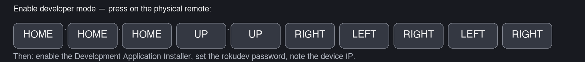
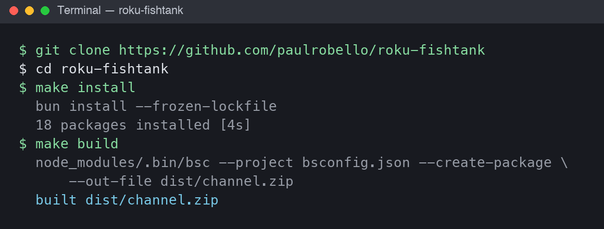
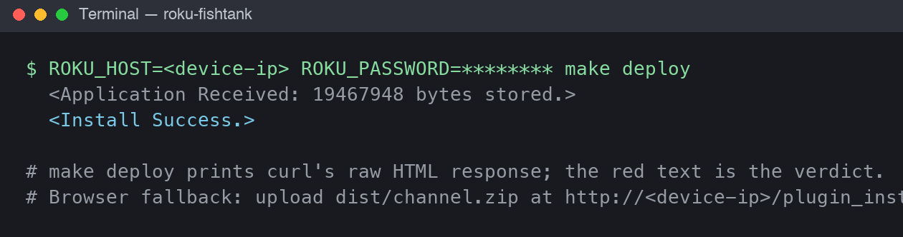

# Reef Tank — install guide

Step-by-step installation with screenshots: enable developer mode on the Roku, build the
channel on a computer, sideload it, and set it as the screensaver. Time: about ten minutes
plus one reboot. The tank runs on any recent Roku (reference devices: Roku Ultra 4850X and
4800X on OS 15.3.4 — measured 60 fps at the default density on both).

## Step 1 — Enable developer mode on the Roku

On the physical remote, press the hidden key sequence (Home three times, Up twice, then
Right-Left-Right-Left-Right). The developer setup screen opens.

On that screen:

1. Enable the **Development Application Installer**. The Roku reboots once.
2. Set the `rokudev` password when prompted — every sideload authenticates with it.
3. Note the device IP from the developer screen (or Settings > Network > About). The
   installer page is then at `http://<device-ip>/plugin_install`.

Developer mode survives reboots; it only turns off if you disable it or factory-reset.
The screensaver picker lists sideloaded screensavers under the entry **dev** — that label
is the platform's placeholder for sideloaded apps, not an error.

## Step 2 — Build the channel on a computer

Clone, install the pinned toolchain (bun), and package the device channel:

`dist/channel.zip` is the sideload package.

## Step 3 — Sideload to the Roku

**Exit any running screensaver first** (press any key on the remote): deploying while the
screensaver runs wedges the channel until a device reboot.

From the repo root (`make deploy` reads `ROKU_HOST`/`ROKU_PASSWORD` from a gitignored
`.env`, or pass them inline):

`Install Success.` is the confirmation. Only one sideloaded channel exists per device;
each deploy replaces it. Browser fallback: open `http://<device-ip>/plugin_install` in a
browser, authenticate with the `rokudev` password, and upload `dist/channel.zip` (the same
digest-auth page `make deploy` uses).

## Step 4 — Set Reef Tank as the screensaver

On the Roku: **Settings > Theme > Screensavers**, find the **dev** entry, open it, and
choose **Set as screensaver** (highlighting alone is not enough — the old screensaver
stays default until you confirm on the detail screen). Shorten the wait timer
(**Settings > System > Power > screensaver wait** equivalent) so the tank appears sooner.

The result on real devices:

| 4850X — day | 4800X — day | 4800X (second) — day |
|---|---|---|
|  |  |  |

Any remote keypress exits the screensaver (platform behavior). Debug output is on telnet
port 8087 while it runs.

## Uninstall / disable

Updates never need an uninstall: each `make deploy` replaces the sideloaded package
(verified on all three reference devices). To remove the tank entirely, disable developer
mode via the Step-1 developer screen — per Roku's development-environment documentation,
the screen's disable options remove the dev application; we have not needed an uninstall
in practice, so the exact menu flow is not photographed here.

## Troubleshooting

- **`Install failed` on deploy** — wrong `rokudev` password, or the screensaver was
  running (exit it and retry; a wedged device needs a reboot).
- **Tank doesn't appear on idle** — the picker still has another screensaver set, or the
  wait timer is long. Re-run Step 4 and shorten the timer.
- **Picker shows a blank preview pane** — cosmetic for sideloaded apps: the pane is fed
  by store artwork, which sideloads don't have.
- **60 fps questions** — measured numbers per device model are in
  [docs/perf.md](perf.md); other Roku models are untested.
